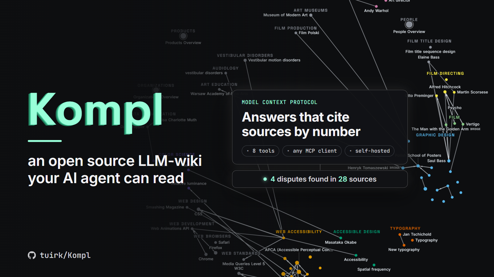
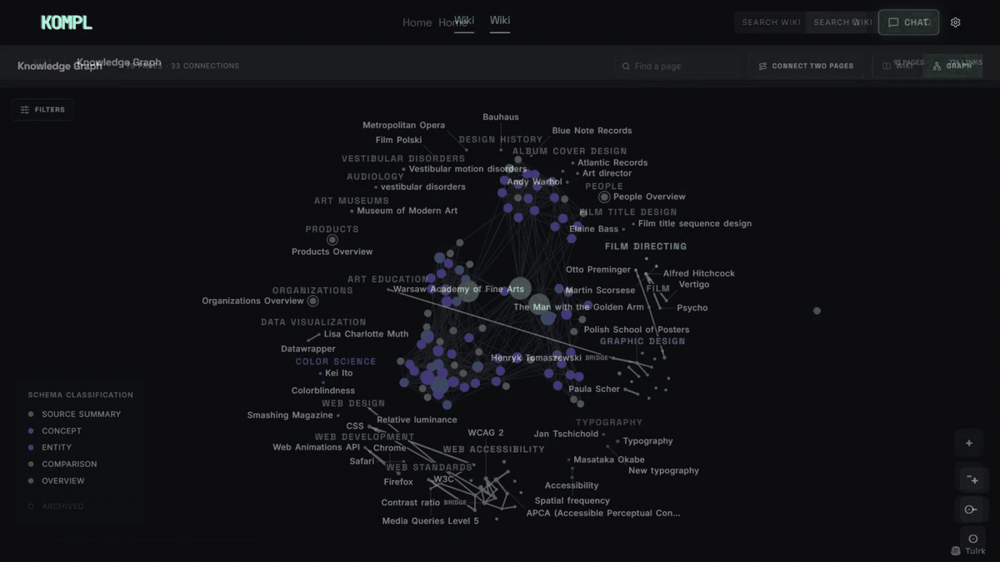
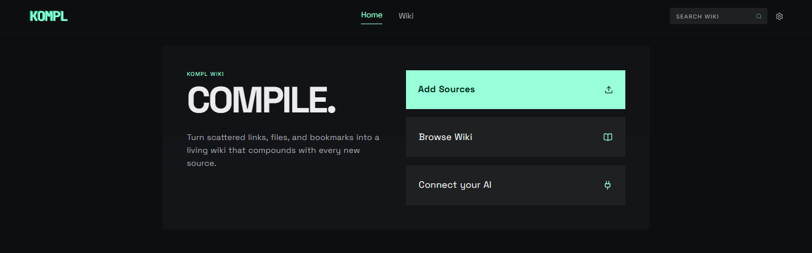
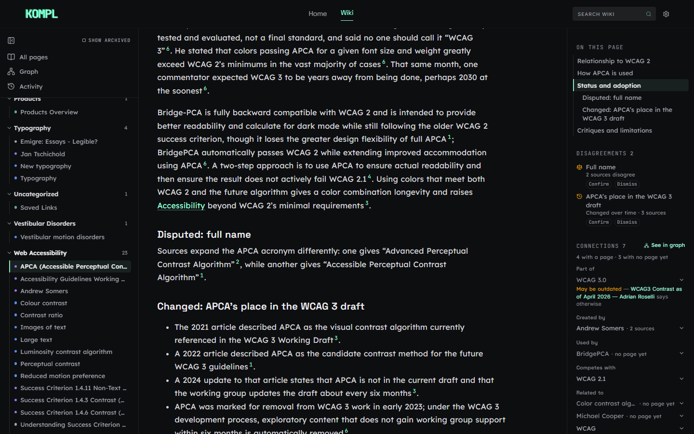
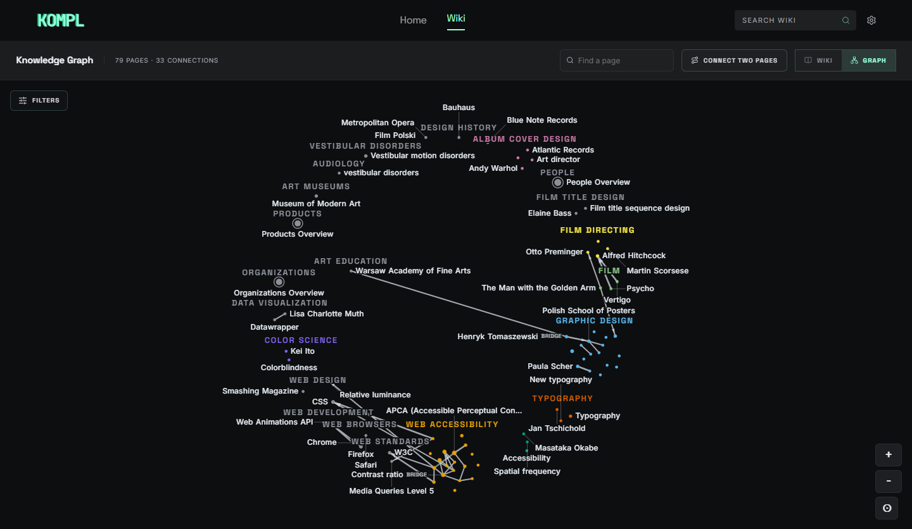
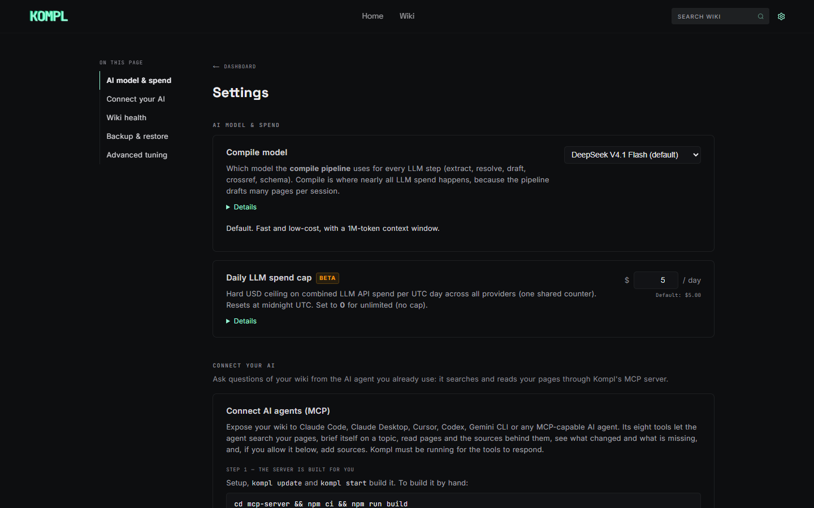
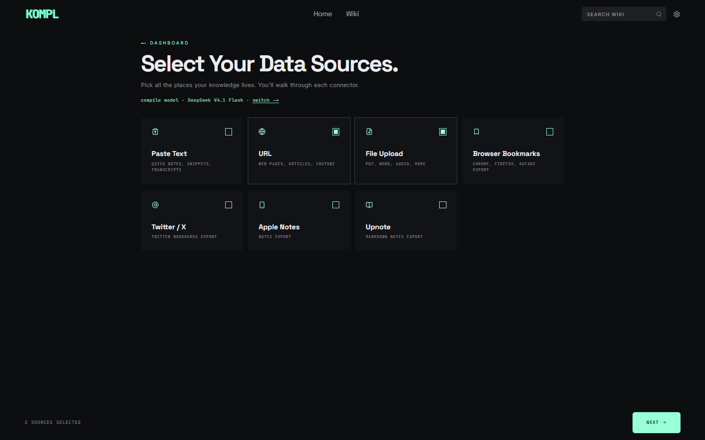
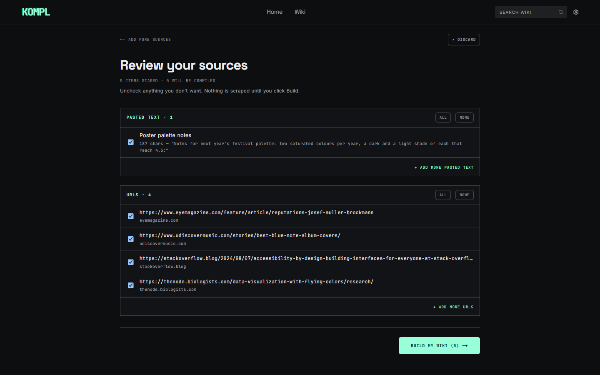
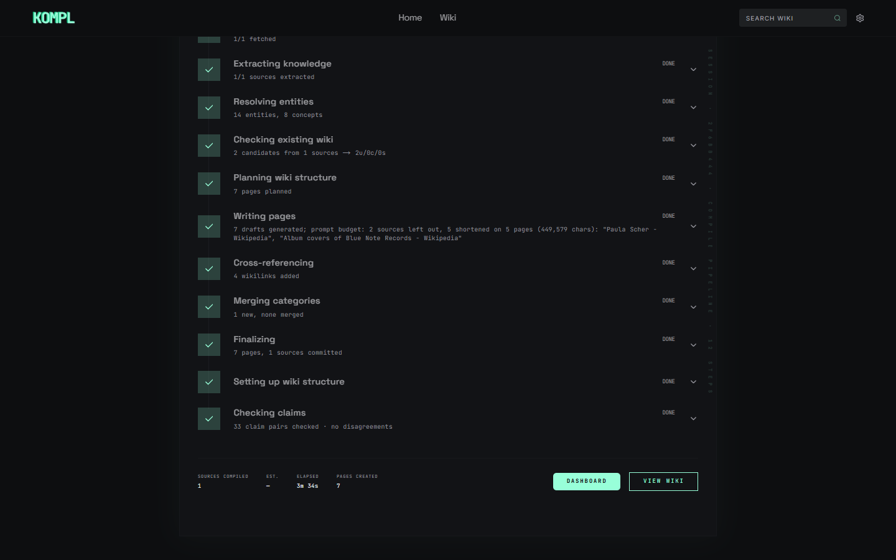

<p align="center">
  
</p>

<h1 align="center">Kompl</h1>

<p align="center">
  <b>Stop saving. Start compiling.</b><br>
  A self-hosted wiki that writes and maintains itself from what you save,<br>
  and answers your AI agent over MCP.
</p>

<p align="center">
  <a href="LICENSE"></a>
  <a href="https://github.com/tuirk/Kompl/actions"></a>
  <a href="docker-compose.yml"></a>
  
  
  <a href="https://scorecard.dev/viewer/?uri=github.com/tuirk/Kompl"></a>
</p>

---

Save anything (a link, a PDF, a thread, a YouTube video, a bookmark export) and
Kompl reads it as it arrives, pulls out the people, ideas and arguments inside,
and writes them into wiki pages that link to each other. Save more on the same
topic and the existing pages update. Save a tenth and Kompl already sees the
pattern across all ten without you having to ask.

- **Compiles at save time, not at question time.** Source #50 doesn't just become
  page #51: it rewrites the pages it touches, so the wiki never needs upkeep.
- **Grows its own structure.** Entities and concepts that keep showing up get
  their own pages, and a topic map shows how they connect, each connection with
  the sentence that states it.
- **Says when sources disagree.** A page records a disputed claim with both
  sides cited, and a claim that a newer source changed with its dates. You
  confirm or dismiss each finding.
- **Shows its sources.** Claims carry numbered citations that link to the
  sources each page was built from, so you can check any sentence.
- **Answers through the agent you already use.** Claude Code, Claude Desktop,
  Cursor or any MCP client reads the compiled pages through Kompl's MCP server.
- **Runs on your machine, with your keys.** One Docker stack, a CLI, and your
  own DeepSeek or Gemini key. No accounts, no telemetry.

**Watch the 1-minute demo:**

[](https://youtu.be/6zVYz6aHU1k)



| Dashboard | Compiled wiki page |
|---|---|
|  |  |
| **Topic map** | **Settings: model, spend cap and MCP** |
|  |  |

## How it works

```mermaid
flowchart LR
    A["Save a source<br/>URL · file · thread · video · bookmarks"] --> B["Local NLP<br/>entities · keyphrases · TF-IDF"]
    B --> C["One LLM call<br/>extracts entities, claims, contradictions"]
    C --> D["Entity resolution<br/>alias → fuzzy → embeddings → LLM"]
    D --> E["Page plan<br/>ranked by TF-IDF, confirmed by triage"]
    E --> F["LLM drafts and rewrites pages<br/>with citations"]
    F --> X["Claim check<br/>disputed · changed"]
    X --> G[("Your wiki")]
    G --> H["Your AI agent<br/>via MCP"]
```



Local work comes first on purpose: an LLM shouldn't be paid to do a librarian's
job. The model's real job is writing, drafting or rewriting each affected page
with the new source woven in. Details are in [Under the hood](#under-the-hood).

## Quick start

You need **Docker** (Desktop on Windows/macOS, Engine + Compose v2 on Linux) running,
**Node.js 24+**, about **5 GB disk and 4 GB free RAM**, and the API keys below.

**macOS / Linux / WSL / Git Bash**

```bash
curl -fsSL https://raw.githubusercontent.com/tuirk/Kompl/main/install.sh | bash
```

**Windows (PowerShell)**

```powershell
irm https://raw.githubusercontent.com/tuirk/Kompl/main/install.ps1 | iex
```

The installer checks Docker, Node 24, disk and RAM, clones the repo and hands off
to `setup.js`, which asks for your keys, writes `.env` (gitignored, along with your
detected timezone as `KOMPL_TIMEZONE`), installs the `kompl` CLI and starts the
stack. If anything is missing it stops with a copy-paste fix. Prefer to read the
script first? Download it with `curl -fsSLO` (or `iwr -OutFile`), then run
`bash install.sh` (or `.\install.ps1`).

<details>
<summary>Manual install</summary>

```bash
git clone https://github.com/tuirk/Kompl.git kompl
cd kompl
node setup.js
```

</details>

**The first start takes 5–10 minutes** while Docker builds the images (~2 GB) and
downloads the local embedding model. Later starts take about 15 seconds.

```bash
kompl status     # wait until the app reports healthy
kompl open       # or visit http://localhost:3000
```

The onboarding wizard walks you through your first sources: paste a URL, drop a
PDF, or import a bookmark or Twitter export.

| 1. Choose your sources | 2. Review before compiling | 3. Watch it compile |
|---|---|---|
|  |  |  |

### API keys

**Firecrawl** and **at least one compile provider** (DeepSeek or Gemini) are
required; **YouTube** is optional. Pick or change the compile model any time in
**Settings → AI model & spend**.

| Key | Needed for | Get it | Notes |
|---|---|---|---|
| **Firecrawl** | URL scraping. Required. | [firecrawl.dev](https://firecrawl.dev) | Free tier (500 scrapes/month) covers normal personal use. |
| **DeepSeek** | Compilation (one of two\*) | [api-docs.deepseek.com](https://api-docs.deepseek.com) | **Default for new installs: DeepSeek V4.1 Flash.** V4 Pro is also selectable and was validated on long academic sources (~200K characters). Pay-as-you-go. |
| **Gemini** | Compilation (one of two\*) | [aistudio.google.com/apikey](https://aistudio.google.com/apikey) | Gemini 3.8 Flash, 3.5 Flash-Lite and 3.1 Pro (preview). Gemini 2.5 still works, but Google only serves it to API projects that used it before. Paid Tier 1 is strongly recommended: free-tier rate limits throttle a normal ingest. |
| **YouTube Data API v3** | YouTube metadata. Optional. | [console.cloud.google.com](https://console.cloud.google.com/apis/library/youtube.googleapis.com) | 10,000 units/day free (1 unit per video). Captions use `youtube-transcript-api` (no key). Without this key, YouTube URLs land on **Saved Links** (`youtube_metadata_unavailable`) instead of being compiled. Restrict the key to YouTube Data API v3. |

\*At least one of DeepSeek or Gemini. If you only set a Gemini key, choose a
Gemini model in Settings before your first compile.

Installs from before DeepSeek became the default keep the model they were already
using; nothing switches providers on update.

## Ask your wiki from your AI (MCP)

Kompl has no built-in chat. Your agent asks the questions and Kompl serves the
compiled pages, with provenance back to the originals instead of raw chunks.
**Settings → Connect your AI** has the same steps.

**Build.** Setup and `kompl update` build the MCP server for you, and
`kompl start` rebuilds it when its build is older than its source. To build it
by hand: `cd mcp-server && npm ci && npm run build`. Restart your agent after
an update to load the new tools.

**Connect your agent.** The server is a local process that your agent starts:
`node <KOMPL_INSTALL_PATH>/mcp-server/dist/index.js`, with `<KOMPL_INSTALL_PATH>`
replaced by the absolute path to your Kompl folder. It talks to Kompl at
`KOMPL_URL` (default `http://localhost:3000`).

| Agent | Setup |
|---|---|
| Claude Code | `claude mcp add --scope user kompl-wiki -- node <KOMPL_INSTALL_PATH>/mcp-server/dist/index.js` |
| Codex (CLI, IDE extension, ChatGPT desktop app) | `codex mcp add kompl-wiki -- node <KOMPL_INSTALL_PATH>/mcp-server/dist/index.js` |
| Claude Desktop, Cursor, Gemini CLI | the block below in `claude_desktop_config.json`, `~/.cursor/mcp.json` or `~/.gemini/settings.json` |
| Pi | the block below in `~/.pi/agent/mcp.json`, read by the `pi-mcp-adapter` extension |
| VS Code | the block below in `.vscode/mcp.json`, with `"servers"` in place of `"mcpServers"` |
| Hermes Agent | under `mcp_servers:` in `~/.hermes/config.yaml`: `kompl-wiki: { command: node, args: ["<KOMPL_INSTALL_PATH>/mcp-server/dist/index.js"] }` |

```json
{
  "mcpServers": {
    "kompl-wiki": {
      "type": "stdio",
      "command": "node",
      "args": ["<KOMPL_INSTALL_PATH>/mcp-server/dist/index.js"],
      "env": { "KOMPL_URL": "http://localhost:3000" }
    }
  }
}
```

> **Pi and Hermes run tools without asking you first.** If you turn on *Let AI
> agents add sources*, they can add sources and start compiles (which count
> toward your daily spend cap) on their own. Leave it off unless you're
> comfortable with that.

**Tools.** All but `add_source` only read. Kompl must be running
(`kompl start`) for them to answer.

| Tool | What it does |
|---|---|
| `search_wiki` | Finds pages by keywords and meaning; without a query, lists pages newest first |
| `research_topic` | One-call brief on a topic: key pages, their cited lines, how they connect, one source list numbered across them, disputes, gaps |
| `read_page` | A page with `[n]` citations, its numbered sources (address and date), how it connects to other pages (each relation with its source), and the disagreements recorded on it |
| `read_source` | The original text behind a source or a page's citation `[n]`, or just the passages that match a query |
| `list_sources` | What you've added, searchable by title or address |
| `recent_changes` | What changed since a date, in one compile, or on one page (with the sections that changed) |
| `wiki_status` | Size, a running compile, what waits for you, gaps worth filling, topic clusters and bridge pages |
| `add_source` | Saves links (up to 5 at a time) or a note and compiles them. Off until you turn it on in **Settings → Connect your AI**; at most 20 a day |

Not using MCP? The same data is on plain HTTP: `/api/pages/search?mode=hybrid`,
`/api/wiki/research`, `/api/wiki/{page_id}/data`, `/api/sources`,
`/api/sources/{id}/content`, `/api/wiki/changes`, `/api/wiki/status` and
`/api/wiki/index`.

> ⚠ **Single-tenant.** There is no multi-user auth. Don't expose your instance to
> the internet without putting your own auth in front of it. Kompl answers only to
> `localhost`, IP addresses and its own service names (`app`, `nlp-service`,
> `n8n`), and refuses any change a page on another site asks for. If your proxy
> serves Kompl under its own host name, or an agent in a container reaches it as
> `host.docker.internal`, list that name in `KOMPL_ALLOWED_HOSTS` in `.env`, or
> every request to it gets `403 unknown_host`.

## Everyday use

| Command | What it does |
|---|---|
| `kompl start` | Start Kompl (also saves a local backup if the last one is more than 36 hours old) |
| `kompl stop` / `kompl restart` | Stop, or stop and start |
| `kompl open` | Open the app in your browser |
| `kompl status` | Health check: app, database, NLP service, vector index |
| `kompl logs` | Stream service logs |
| `kompl update` | Pull the latest source, rebuild images and restart (~5–10 min) |
| `kompl backup` | Save a full backup to `~/.kompl/backups/kompl-backup.kompl.zip` |
| `kompl init` | Re-run the first-time setup wizard (rarely needed) |

If something looks stuck, start with `kompl status` and `kompl logs`. The usual
first-run causes are Docker not running, port 3000 already in use, or the first
image build still downloading.

## Updating

```bash
kompl backup     # optional, recommended before major upgrades
kompl update
```

What changed in each release: [CHANGELOG.md](CHANGELOG.md).

`kompl update` pulls the source, refreshes the CLI, pulls registry images,
rebuilds `app` and `nlp-service` and waits for `/api/health`. **Your wiki is safe
on a normal update:** pages live on the Docker volume `kompl-data`, which
rebuilds don't touch. `kompl start` and `kompl restart` only restart existing
images; they don't rebuild after a `git pull`, so new UI won't appear until you
run `kompl update`.

<details>
<summary>Manual update</summary>

```bash
cd <projectDir>    # path in ~/.kompl/config.json
git pull --ff-only
cd cli && npm install && npm link    # npm install also builds the CLI
cd ..
docker compose pull
docker compose up --build -d
```

</details>

> ⚠ **Never** run `docker compose down -v` unless you mean to delete everything:
> `-v` removes the volumes. `bash scripts/integration-test.sh` is destructive too.

## Backup and restore

**Settings → Backup & restore → Kompl Backup** downloads a `.kompl.zip` with your
entire wiki: sources, compiled pages, provenance, extractions and settings. API
keys and third-party secrets are excluded, and restoring needs no LLM calls.

To restore on a fresh instance, run setup, skip onboarding, then upload the
`.kompl.zip` under **Settings → Backup & restore → Import wiki**. Pages are
browsable and searchable immediately; the search index rebuilds in the
background. Backups from older Kompl versions import too.

`kompl start` also saves a local backup to `~/.kompl/backups/kompl-backup.kompl.zip`
at most once every 36 hours.

```bash
kompl backup                                        # save to ~/.kompl/backups/ (overwrites)
kompl backup --output ~/Desktop/my-wiki.kompl.zip   # save to a custom path
kompl backup --schedule                             # weekly backup, Monday 11:30
```

`--schedule` is idempotent. **Windows** registers a Task Scheduler entry (needs
Admin; runs at next login if the machine was off). **Linux** and **macOS** add a
crontab entry (`30 11 * * 1 kompl backup`); cron does not catch up if the machine
was off. *Tested on Windows and Linux only — please
[open an issue](https://github.com/tuirk/Kompl/issues) if you hit anything on
macOS.*

## Your data

Your wiki lives in Docker volumes on your machine. Outbound calls fall into three
groups.

**Calls you trigger, which send content to a third party:**
- **DeepSeek** (`api.deepseek.com`) or **Gemini** (`generativelanguage.googleapis.com`):
  compilation, whichever provider your compile model uses. Your source text is
  sent to that provider.
- **Firecrawl** (`api.firecrawl.dev`): URL scraping fallback. The URL you pasted
  is sent to Firecrawl.
- **GitHub public API** (`api.github.com`): README and metadata when you paste a
  GitHub repo URL.
- **YouTube** (`youtube.com`, `youtube.googleapis.com`): captions through
  `youtube-transcript-api`, then metadata through the YouTube Data API.
- **Link previews:** pasted URLs are fetched once with `User-Agent: KomplBot/1.0`
  for their title and description.

**Once, on first use:** HuggingFace Hub (`huggingface.co`), a ~90 MB download of
the `all-MiniLM-L6-v2` embedding model on the first compile.

**Build time only:** image builds pull from PyPI, npm, Docker Hub and apt mirrors.

Kompl sends no analytics, error reports or version pings. The bundled n8n
container's telemetry, version checks, templates and personalization are disabled
in `docker-compose.yml`.

## Under the hood

Three containers: a **Next.js** app (UI, API and the only process that writes the
SQLite database), an **NLP service** (FastAPI with spaCy, YAKE/RAKE/KeyBERT/TextRank,
TF-IDF, local sentence-transformer embeddings and Chroma, plus the LLM calls), and
**n8n** for orchestration. A source goes through these steps:

- **Local NLP first.** spaCy handles named entities, and a router picks keyphrase
  methods based on how long and how entity-dense the text is, with TF–IDF overlap
  against your existing pages once there is a wiki to compare against. These
  outputs go into the prompt as context, narrowing what the model has to work out.
- **One LLM call extracts** the typed entities, concepts, claims, relationships,
  contradictions and summary for that source.
- **Entity resolution runs as a cascade:** alias and exact-title lookup, then
  name rules (spellings, plurals, abbreviations), then local embeddings, including
  each name's closest names and pages by meaning, with an LLM check reserved for
  the doubtful pairs. Two names become one page only when a rule or that check
  says so.
- **Page targeting is ranked, not generated.** TF–IDF ranks which pages a source
  should touch and a small triage call confirms them. The page plan (source
  summaries, entity, concept and comparison pages) stays deterministic.
- **The LLM's real job is writing:** drafting or rewriting each affected page with
  the new source's contribution and citation woven in. Sources are cited with
  short labels that Kompl stores as references to the source records, and
  wikilinks are injected by deterministic regex afterwards.
- **Labels are merged once per compile:** one LLM call folds near-duplicate
  categories into one.
- **A claim check compares sources:** likely claim pairs from different sources
  are judged by the LLM, and source dates tell a claim that changed over time
  from a live dispute.
- **Commits go through an outbox.** A source is either fully written or left for
  the reconciler at boot. The last two versions of every page are kept, so you
  can see what changed and restore one.

**Upkeep.** Settings → Wiki health runs checks on request, updates pages written
under older rules, and runs **Repair wiki**: a backup first, the plan and cost
shown, then all or none (it re-checks names merged before, rebuilds connections
and tidies links and labels). A compile's progress page offers **Retry failed**
and **Redo** from the plan, writing or saving step, with a preview and cost.

A daily spend cap (Settings → AI model & spend) stops LLM calls for the rest of
the UTC day once the estimated spend reaches your limit.

## Known limitations

- **Single-tenant only:** no user accounts or access control.
- **Dense, long sources on Gemini 2.5:** structured-output truncation on inputs
  above ~50K characters (often academic PDFs and surveys) causes
  `extract_llm_failed`. Switch to DeepSeek V4 Pro for that material; it handled up
  to ~200K characters cleanly in testing. Kompl does not auto-chunk long sources.
  Tracked in [issue #7](https://github.com/tuirk/Kompl/issues/7).
- **Connectors:** URLs (including YouTube transcripts and GitHub READMEs), file
  uploads (PDF, DOCX, PPTX, XLSX, TXT, MD, HTML), browser bookmarks, Twitter JSON
  export, Upnote and Apple Notes.
- **Desktop browser only.** There is no mobile app, and the web UI isn't built
  for small screens.
- **Two names for one thing can stay two pages** when their descriptions don't
  read alike (a rename, a translation, a nickname). Merging is careful on
  purpose: a wrong merge is worse than a duplicate.

## Security

Kompl is built to run on a personal computer behind loopback or a LAN, and its
security posture is calibrated for that.

**Known security debt:**
- Markdown HTML output is not sanitized yet, so Firecrawl-scraped content can
  carry XSS payloads. Even on a single-user install an ingested bookmark can
  deliver one; the fix is DOMPurify in the render pipeline.

**CodeQL alerts.** Some `py/path-injection` and `js/path-injection` alerts re-fire
on every push because CodeQL's taint tracker doesn't follow cross-function
sanitizers. They are dismissed one by one (rather than silenced in config) so any
genuinely new sink surfaces for review. Reasoning per alert:
[docs/security/codeql-false-positives.md](docs/security/codeql-false-positives.md).

**Reporting an issue:** please open a GitHub Security Advisory rather than a
public issue.

## License

Kompl's source is **Apache-2.0** ([LICENSE](LICENSE)): use, modify, fork and
redistribute it freely under those terms.

**One caveat about the bundled n8n container.** Kompl runs `n8nio/n8n` unmodified
as a runtime dependency for workflow orchestration. n8n is licensed under the
[Sustainable Use License](https://docs.n8n.io/sustainable-use-license/), which is
**not OSI-approved**. In practice:

- Self-hosting Kompl for personal or internal use is fully fine.
- Forking and redistributing Kompl source is fine (Apache-2.0 covers Kompl; n8n is
  a runtime dependency users pull themselves).
- Offering **Kompl as a hosted service to third parties** is the line: n8n's SUL
  restricts hosting n8n as a service for others. If your offering bundles n8n,
  contact n8n first.

See [NOTICE](NOTICE) for full attribution.
